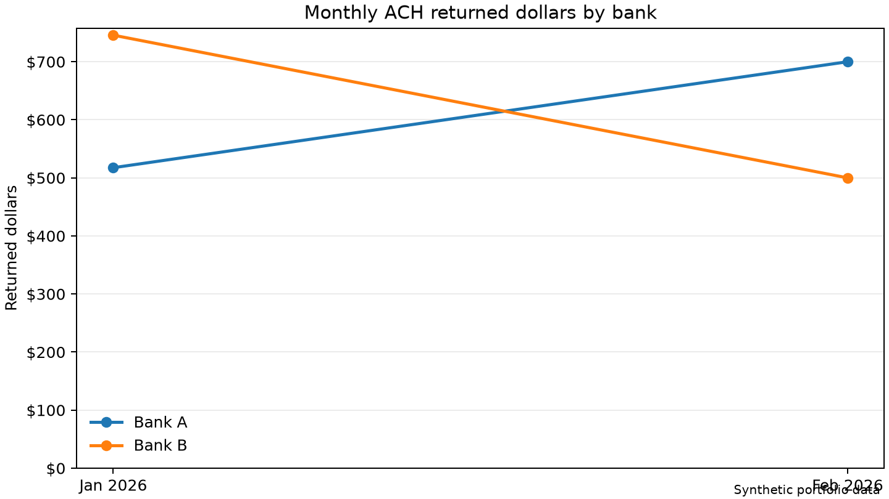

# ACH Returns Reporting

This portfolio project uses synthetic data to recreate part of the monthly
ACH returns reporting workflow I worked on at PayArc. It uses Python and
SQLite to standardize two fictional sponsor-bank exports, check data quality,
reconcile returns to original payments, and compare monthly returned dollars.

## Run the project

From the project folder, run:

```bash
python3 run_pipeline.py
```

The project uses Python 3 and its standard library.

## Inputs

- `raw/` contains January and February return files for two fictional banks.
- `original_transactions.csv` contains the synthetic original payments used
  for reconciliation.

## Outputs

| File | What it shows |
|---|---|
| `standardized_returns.csv` | Both bank layouts combined into one format |
| `reportable_returns.csv` | Returns included in the monthly report |
| `return_exceptions.csv` | Data-quality issues and how each was handled |
| `monthly_returns_summary.csv` | Return counts, returned dollars, and changes from the prior month by bank |

The reconciliation step prints the match status for each return. It checks
for missing original payments and differences between the original and
returned amounts.

## Validation and findings

- The pipeline processed 12 input rows and retained 11 returns totaling
  $2,463.25. It excluded one exact duplicate and kept one return with a
  missing reason code in the dollar totals.
- All 11 retained returns matched their original payments in the final
  sample. I also tested that the SQL flagged a missing original payment
  and an amount mismatch.
- Bank A's returned dollars increased by $182.50 from January to February
  even though its return count stayed at three. Bank B's returned dollars
  decreased by $245.75, and its return count fell from three to two.
- The sample contains returns and selected original payments. It supports
  comparing returned dollars and counts. Calculating return rates would
  require the full volume of originated payments.

## Monthly comparison



Bank A's returned dollars increased by $182.50 while its return count
stayed at three. Bank B's returned dollars fell by $245.75 as its return
count fell from three to two. The chart uses synthetic data.

### Regenerate the chart

Run the reporting pipeline first to create `monthly_returns_summary.csv`.
Then, from the project folder on macOS, run:

```bash
python3 -m venv .venv
source .venv/bin/activate
python -m pip install matplotlib
python chart_returns.py
```